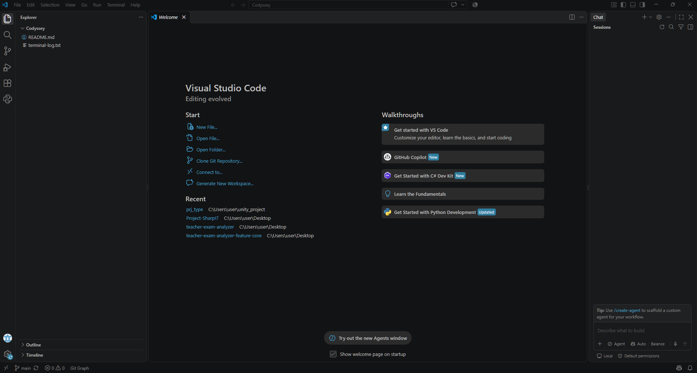

# Codyssey

## 미션 01. 개발 환경 구성

대전 코디세이 입학 연수과정의 첫 번째 과제다. 터미널에서 파일과 권한을 다루고, Docker로 웹 서버를 실행한 뒤 과정과 결과를 GitHub 저장소에 정리한다. 포트 매핑·바인드 마운트·볼륨의 차이를 실제 결과로 확인하고 다른 환경에서도 재현할 수 있게 만드는 것이 목표다.

기본 터미널 조작은 교육장 Windows 노트북에서, Linux 권한과 Docker 실습은 개인 Windows 노트북에서 진행했다. 명령은 **PowerShell**과 **Ubuntu Bash**를 구분해 표시했다.

### 기록과 증거의 구분

- 교육장 기본 명령과 권한 실습 로그는 당시 저장한 원본이다.
- Docker 실습 절차는 수행한 명령을 정리한 것이다. 별도 로그는 **2026-11-04 README 작성 시 실제 환경을 재확인한 결과**이며 최초 실행 전체 출력과 구분한다.
- 최초 실습의 연속 출력이 없던 바인드 마운트·볼륨·attach/exec는 별도 자원으로 재검증하고 명령·출력을 추가했다. 당시 기록과 후속 검증을 구분해 남겼다.

## 진행 상황

- [x] 터미널 기본 조작 및 절대·상대 경로 확인
- [x] 파일·디렉토리 권한 변경 및 전후 로그 확보
- [x] WSL2·Ubuntu 및 Docker 설치·동작 확인
- [x] hello-world 및 Ubuntu 컨테이너 실행
- [x] 컨테이너 시작·중지·목록·로그·리소스 확인
- [x] Dockerfile 작성 및 웹 서버 이미지 빌드
- [x] 8080·8081 포트 매핑 및 HTTP 응답 확인
- [x] 바인드 마운트 파일 변경 반영
- [x] 컨테이너 삭제 후 볼륨 데이터 확인
- [x] Git 사용자 정보·기본 브랜치·원격 저장소 확인
- [x] 트러블슈팅 2건 이상 정리
- [x] attach 연결 해제 직후 Up 및 exit 후 Exited (0) 비교
- [x] 주소창·포트가 보이는 8080·8081 브라우저 캡처 첨부
- [x] VSCode 저장소 열기 및 main 브랜치 화면 첨부
- [x] VSCode GitHub 로그인 완료 상태 화면 첨부
- [x] 변경 파일 커밋·푸시 및 원격 저장소 반영 확인

## 실습 환경

| 구분 | 확인한 환경 |
|---|---|
| 교육장 기본 명령 | Windows PowerShell 5.1.26100.9711 / 2026-11-02 |
| 개인 노트북 OS | Windows 11 Pro / 10.0.26200 / 빌드 26200 |
| 개인 노트북 실습일 | 2026-11-04 (Asia/Seoul) |
| 쉘 | Windows PowerShell 및 Ubuntu Bash; README 재확인용 PowerShell은 7.6.5 |
| 터미널 | PowerShell에서 명령 실행, 저장소는 VSCode에서 열어 작업; 별도 터미널 앱 버전은 미기록 |
| WSL | 3.0.3.0 / Ubuntu 배포판 실행 방식은 WSL2 |
| WSL Ubuntu | Ubuntu 26.04.1 LTS |
| Docker 환경 | Docker Desktop / Linux 컨테이너 / WSL2 커널 |
| Docker CLI·서버 | 29.9.2 / CLI 빌드 a82e528 |
| Git | 2.51.2.windows.1 |
| VSCode | 1.144.1 / x64 |

WSL 프로그램 버전 `3.0.3.0`과 배포판의 WSL 실행 버전 `2`는 서로 다른 항목이다. WSL Ubuntu와 Docker 안의 Ubuntu 컨테이너도 별개다.

```text
PS> docker --version
Docker version 29.9.2, build a82e528
PS> git --version
git version 2.51.2.windows.1
PS> wsl --list --verbose
  NAME              STATE           VERSION
* docker-desktop    Running         2
  Ubuntu            Stopped         2
```

상태는 로그 수집 시점 기준이다. [환경 확인 명령·출력 전체](./logs/environment.txt)

## 1. 터미널과 파일 권한

### 1-1. PowerShell 기본 명령

교육장 노트북에서 수행했다. [기본 명령·출력 원본](./terminal-log.txt)

| 작업 | 명령 | 확인한 결과 |
|---|---|---|
| 현재 위치 | `pwd` | 현재 폴더의 전체 경로 |
| 숨김 파일 포함 목록 | `ls -Force` | memo.txt와 terminal-log.txt 확인 |
| 절대·상대 경로 이동 | `cd C:\Users\User\Documents\codyssey-practice\practice2`, `cd .\practice2`, `cd ..` | 이동 후 pwd로 위치 확인 |
| 폴더 생성 | `mkdir practice2` | practice2 생성 |
| 빈 파일 생성 | `ni .\practice2\note.txt` | 크기 0인 파일 생성 |
| 내용 저장·조회 | `echo "CLI practice" > .\practice2\note.txt`, `cat .\practice2\note.txt` | CLI practice 출력 |
| 복사 | `cp .\practice2\note.txt .\practice2\copy.txt` | 복사본 생성 |
| 이름 변경·이동 | `mv .\practice2\copy.txt .\practice2\backup.txt`, `mv .\practice2\backup.txt .` | 상위 폴더에서 내용 조회 |
| 삭제 | `rm .\practice2\note.txt`, `rm .\practice2`, `rm .\backup.txt` | 마지막 ls에서 연습 파일·폴더가 사라짐 |

원본 발췌:

```text
PS C:\Users\User\Documents\codyssey-practice> cat .\practice2\note.txt
CLI practice
PS C:\Users\User\Documents\codyssey-practice> cat .\backup.txt
CLI practice
```

절대 경로는 `C:\Users\User\Documents\codyssey-practice\practice2`처럼 위치 전체를 지정한다. 상대 경로 `.\practice2`는 현재 위치를 기준으로 하며 `..`는 상위 폴더다. 상대 경로는 현재 작업 위치에 따라 대상이 달라진다.

### 1-2. Ubuntu 파일·디렉토리 권한

PowerShell에서 `wsl -d Ubuntu`로 들어가, `/mnt/c` 대신 Ubuntu 홈 디렉토리에서 진행했다.

```bash
cd ~
mkdir -p codyssey-practice/permissions
cd ~/codyssey-practice/permissions
script -a permissions-log.txt
touch note.txt
mkdir test-dir
ls -ld note.txt test-dir
chmod 644 note.txt
chmod 755 test-dir
ls -ld note.txt test-dir
chmod 600 note.txt
chmod 700 test-dir
ls -ld note.txt test-dir
exit
```

마지막 exit는 script가 만든 기록용 셸을 종료한다. 원본 출력 발췌:

```text
$ ls -ld note.txt test-dir
-rw-r--r-- 1 chungho chungho    0 Nov  4 11:41 note.txt
drwxr-xr-x 2 chungho chungho 4096 Nov  4 11:41 test-dir
$ chmod 600 note.txt
$ chmod 700 test-dir
$ ls -ld note.txt test-dir
-rw------- 1 chungho chungho    0 Nov  4 11:41 note.txt
drwx------ 2 chungho chungho 4096 Nov  4 11:41 test-dir
```

| 대상 | 변경 전 | 변경 후 | 권한 차이 |
|---|---|---|---|
| note.txt | 644 / `-rw-r--r--` | 600 / `-rw-------` | 그룹·기타 사용자의 읽기 권한 제거 |
| test-dir | 755 / `drwxr-xr-x` | 700 / `drwx------` | 그룹·기타 사용자의 목록 조회·진입 권한 제거 |

초기 권한이 이미 644·755라서 동일 값으로 설정하면 바뀌지 않았다. 600·700으로 다시 바꿔 차이를 확인했다. 권한 비트 변경까지 확인했으며, 다른 사용자로 접근하는 실험까지 수행한 것은 아니다.

- r=4, w=2, x=1을 더해 소유자·그룹·기타 사용자 순서로 표시한다.
- 755는 `rwx / r-x / r-x`, 644는 `rw- / r-- / r--`다.
- 파일에서 r/w/x는 읽기/쓰기/실행이다.
- 디렉토리에서 r은 목록 조회, w는 항목 생성·삭제·이름 변경, x는 진입 및 내부 경로 접근이다. 내부 항목 조작에는 보통 w와 x가 함께 필요하다.

[권한 실습 원본](./logs/permissions-original.txt)에는 터미널 제어 문자와 입력 수정 흔적이 있다. [현재 권한 로그](./logs/permissions-current.txt)에서도 600·700을 재확인했다.

## 2. Docker 설치와 컨테이너 실행

### 2-1. 설치·점검 및 hello-world

PowerShell에서 `wsl --install`을 실행한 뒤 Ubuntu를 추가 설치하고 Linux 사용자 계정을 만들었다. Docker Desktop 설치·실행 후 PowerShell에서 Docker CLI를 사용했다.

```powershell
wsl --version
wsl --list --verbose
docker --version
docker info
docker run hello-world
```

최초 성공 시 공유한 출력 발췌:

```text
PS> docker run hello-world
Unable to find image 'hello-world:latest' locally
latest: Pulling from library/hello-world
Status: Downloaded newer image for hello-world:latest

Hello from Docker!
This message shows that your installation appears to be working correctly.
```

로컬에 이미지가 없다는 안내 후 Docker Hub에서 이미지를 받아 실행했다. CLI → 데몬 → 이미지 다운로드 → 컨테이너 실행 흐름을 확인했다. hello-world는 출력 후 종료하므로 Exited (0)이 정상이다. [데몬 점검](./logs/environment.txt), [실제 hello-world 컨테이너 로그](./logs/docker-operations.txt)

### 2-2. Ubuntu 컨테이너 및 attach·exec

PowerShell에서 실행:

```powershell
docker run -it --name ubuntu-practice ubuntu bash
```

컨테이너 안의 Bash에서 실행:

```bash
pwd
ls -la
echo "Hello from Ubuntu container"
cat /etc/os-release
exit
```

PowerShell로 돌아온 뒤 실행:

```powershell
docker ps
docker ps -a
docker run -d --name ubuntu-running ubuntu sleep infinity
docker exec -it ubuntu-running bash
```

exec로 연 Bash에서 실행:

```bash
echo "Connected using docker exec"
exit
```

PowerShell에서 시작·중지와 attach도 실습했다.

```powershell
docker ps
docker stop ubuntu-running
docker start ubuntu-running
docker start ubuntu-practice
docker attach ubuntu-practice
```

attach로 연결한 Bash에서 `echo "attach practice"`를 실행했다. 컨테이너를 유지하며 연결만 끊을 때는 Ctrl+P, Ctrl+Q를 순서대로 누른다.

| 방식 | 연결 대상 | exit 또는 연결 해제의 의미 |
|---|---|---|
| run -it ... bash | 주 프로세스 Bash | exit로 주 프로세스를 종료하면 컨테이너 종료 |
| exec -it ... bash | 새로 추가한 Bash | exit로 추가 Bash만 종료; sleep infinity는 유지 |
| attach | 기존 주 프로세스 입출력 | Bash가 주 프로세스라면 exit로 컨테이너 종료 |
| attach 후 Ctrl+P, Ctrl+Q | 연결만 해제 | 주 프로세스·컨테이너 유지 |

**최초 실습 기록:** 원래 로그에는 Hello from Ubuntu container, attach practice 및 컨테이너 안에서 docker 명령을 실행해 command not found가 나온 기록이 남았다. 원래 두 연습 컨테이너의 종료 코드는 137이었다. 이를 정상 exit 결과인 0으로 바꾸어 기록하지 않았다.

**후속 대화형 검증:** 별도 컨테이너 codyssey-final-attach에서 실제 attach 연결을 열고 Ctrl+P, Ctrl+Q로 분리했다. 이후 ps에서 Up, inspect에서 Running=true를 확인했다. 다시 attach해 Bash에서 exit를 실행한 뒤 Exited (0), Running=false를 확인했다. 분리 때 read escape sequence가 출력됐으나 컨테이너가 유지된 사실은 별도로 확인했다.

```text
Ctrl+P, Ctrl+Q 후:
Running=true; ExitCode=0
다시 attach하여 exit 후:
Running=false; ExitCode=0
```

exec도 별도 컨테이너에서 `bash -c "echo 'Connected using docker exec'; exit 0"`로 만든 Bash가 종료된 뒤 주 프로세스 sleep infinity와 Running=true가 유지됨을 확인했다. 이번 재검증의 exec는 비대화형이며, 최초 실습의 -it 방식과 구분한다.

[attach 실제 TTY 명령·출력](./logs/attach-verification.txt), [exec 검증 명령·출력](./logs/exec-verification.txt)

### 2-3. 기본 운영 명령

```powershell
docker images
docker ps
docker ps -a
docker logs ubuntu-practice
docker logs ubuntu-running
docker stats --no-stream
docker stop ubuntu-practice ubuntu-running
```

다운로드는 docker run 때 자동으로 이루어졌다. images는 이미지, ps는 실행 중인 컨테이너, ps -a는 종료된 컨테이너까지 보여준다. logs는 프로세스의 표준 출력·오류를 확인하며 sleep infinity처럼 출력하지 않는 프로세스는 로그가 비어 있을 수 있다. stats --no-stream으로 CPU·메모리 사용량을 한 번 확인했다.

[이미지·컨테이너·로그·리소스의 실제 명령과 출력](./logs/docker-operations.txt)

## 3. Dockerfile로 웹 서버 만들기

베이스로 nginx:alpine을 선택했다. 웹 서버가 준비된 이미지에 직접 작성한 HTML을 복사하는 방식으로 콘텐츠를 바꿨다.

[Dockerfile](./Dockerfile), [웹 페이지 소스](./site/index.html)

```dockerfile
FROM nginx:alpine
LABEL org.opencontainers.image.title="codyssey-web"
COPY site/ /usr/share/nginx/html/
EXPOSE 80
```

| 변경 항목 | 목적 |
|---|---|
| LABEL | 프로젝트 정보 표시 |
| COPY | NGINX 기본 콘텐츠를 직접 작성한 HTML로 교체 |
| EXPOSE 80 | 컨테이너 서비스의 포트 정보 명시 |

EXPOSE만으로 호스트 포트가 연결되지는 않는다. 실제 연결은 실행 시 -p로 지정했다. 최초 작업 폴더는 `C:\Users\user\codyssey-web`였고 제출 파일은 이 저장소로 복사했다. 다음 명령은 Dockerfile과 site가 있는 폴더에서 실행한다.

```powershell
docker build -t codyssey-web:1.0 .
docker run -d --name codyssey-web-8080 -p 8080:80 codyssey-web:1.0
docker ps
curl.exe http://localhost:8080
```

현재 1.0 이미지와 실행 중인 웹 컨테이너가 존재하고 HTTP 응답을 확인했다. 최초 빌드 전체 출력은 없어 README 작성 시 **현재 소스를 별도 태그 codyssey-web:readme-check로 재빌드**했다. naming to docker.io/library/codyssey-web:readme-check done까지 성공했다. [빌드 명령·출력](./logs/build-verification.txt)

현재 저장소 HTML은 마운트 실습 후 수정한 버전이다. 현재 소스를 새로 빌드하면 수정된 제목이 포함되므로 실습 당시 만든 기존 1.0 이미지와 제목이 다를 수 있다.

## 4. 포트 매핑

| 컨테이너 | 매핑 | 접속 주소 | 확인한 제목 |
|---|---|---|---|
| codyssey-web-8080 | 8080:80 | http://localhost:8080 | 나의 첫 Docker 웹 서버 |
| codyssey-web-bind | 8081:80 | http://localhost:8081 | 바인드 마운트 변경 반영 성공! |

`-p 호스트포트:컨테이너포트` 순서로 설정했다. 호스트 8080·8081의 요청을 각 컨테이너의 NGINX 80 포트로 전달한다. 서로 다른 컨테이너의 내부 포트는 같아도 되지만, 같은 호스트 주소의 포트를 중복 사용할 수는 없다.

실제 HTTP 응답에서 h1 부분 발췌:

```text
PS> curl.exe --fail --silent --show-error http://localhost:8080
  <h1>나의 첫 Docker 웹 서버</h1>
PS> curl.exe --fail --silent --show-error http://localhost:8081
  <h1>바인드 마운트 변경 반영 성공!</h1>
```

[포트 설정 및 전체 HTML 응답](./logs/web-and-mount.txt)

### 브라우저 접속 증거

첫 번째 화면은 주소창의 localhost:8080과 커스텀 웹 페이지를 함께 보여준다.


두 번째 화면은 localhost:8081에서 호스트 파일 수정 후의 제목이 표시되는 것을 보여준다.


## 5. 바인드 마운트와 볼륨

### 5-1. 바인드 마운트

최초 작업 폴더에서 site를 NGINX 웹 경로에 읽기 전용으로 연결했다.

```powershell
docker run -d --name codyssey-web-bind -p 8081:80 --mount "type=bind,source=$($PWD.Path)\site,target=/usr/share/nginx/html,readonly" codyssey-web:1.0
curl.exe http://localhost:8081
(Get-Content -Raw -Encoding utf8 .\site\index.html).Replace(
  '나의 첫 Docker 웹 서버',
  '바인드 마운트 변경 반영 성공!'
) | Set-Content -Encoding utf8 .\site\index.html
curl.exe http://localhost:8081
curl.exe http://localhost:8080
```

| 항목 | 내용 |
|---|---|
| 실제 호스트 경로 | C:\Users\user\codyssey-web\site |
| 컨테이너 경로 | /usr/share/nginx/html |
| 수정 파일 | site/index.html |
| 변경 전 제목 | 나의 첫 Docker 웹 서버 |
| 변경 후 제목 | 바인드 마운트 변경 반영 성공! |
| 현재 비교 | 8081만 수정한 제목, 8080은 빌드 당시 제목 |

이미지 재빌드나 컨테이너 재시작 없이 호스트 수정이 반영됐다. readonly는 컨테이너에서 쓰기를 막지만 호스트에서 수정하는 것은 가능하다. 연결된 호스트 폴더는 해당 경로의 이미지 내부 파일을 가린다.

**제출 저장소의 site는 원래 폴더의 사본이다.** 기존 8081 컨테이너는 여전히 원래 호스트 경로를 연결하므로 저장소 사본만 수정해서는 반영되지 않는다. 재현 시에는 저장소의 site를 새 컨테이너에 연결한다.

[실제 마운트 경로·읽기 전용 설정·응답 비교](./logs/web-and-mount.txt), [8081 변경 후 화면](./screenshots/web-8081-after.png).

4절의 8080 화면은 이미지에 복사된 원래 콘텐츠이고, 8081 화면은 바인드 마운트 수정 후 콘텐츠다. 서로 다른 포트이므로 동일한 8081 페이지의 변경 전후 캡처라고 표시하지 않았다.

동일 주소의 전후 증거는 별도 호스트 폴더 사본을 마운트한 codyssey-final-bind로 보완했다. localhost:8084에서 수정 전 제목은 바인드 마운트 변경 반영 성공!, 수정 후 제목은 바인드 마운트 재검증 완료!였다. 컨테이너 재시작·이미지 재빌드 없이 같은 주소의 응답이 달라졌다. 기존 소스와 8080·8081 컨테이너는 수정하지 않았고 검증용 컨테이너는 종료 후 삭제했다.

[같은 포트의 파일 수정 명령·변경 전후 전체 응답](./logs/bind-before-after.txt)

### 5-2. Docker 볼륨 영속성

수행한 절차:

```powershell
docker volume create codyssey-data
docker run -d --name volume-before --mount type=volume,source=codyssey-data,target=/data ubuntu sleep infinity
docker exec volume-before bash -c "echo 'Codyssey volume persistence test' > /data/hello.txt"
docker exec volume-before cat /data/hello.txt
docker rm -f volume-before
docker run -d --name volume-after --mount type=volume,source=codyssey-data,target=/data ubuntu sleep infinity
docker exec volume-after cat /data/hello.txt
docker stop volume-after
```

| 시점 | 컨테이너 | 볼륨 | 조회 내용 |
|---|---|---|---|
| 삭제 전 | volume-before | codyssey-data | Codyssey volume persistence test |
| 재생성 후 | volume-after | codyssey-data | Codyssey volume persistence test |

위 표는 실습 완료 보고에 따른 정리이며 최초 삭제 전후의 연속 출력은 따로 보관하지 못했다. README 작성 시 volume-before가 없고 volume-after가 같은 볼륨을 연결한 상태임을 확인했다. 기존 볼륨을 새 임시 컨테이너에 읽기 전용으로 연결해 다시 조회한 결과는 다음과 같다.

```text
PS> docker run --rm --mount type=volume,source=codyssey-data,target=/data,readonly ubuntu cat /data/hello.txt
Codyssey volume persistence test
```

파일이 컨테이너의 쓰기 계층이 아닌 별도 볼륨에 저장되어 유지됐다. 바인드 마운트는 지정한 호스트 경로, 이름 있는 볼륨은 Docker가 관리하는 저장소를 연결한다. 전자는 소스 변경 반영에, 후자는 컨테이너와 수명을 분리할 데이터 저장에 사용할 수 있다.

[볼륨 정보·연결·새 컨테이너 재조회 로그](./logs/volume-verification.txt)

### 5-3. 볼륨 삭제 전후 연속 로그 보완

최초 실습에서 누락된 연속 출력은 별도 볼륨 codyssey-final-data와 두 컨테이너 codyssey-final-before·codyssey-final-after로 재검증했다. 파일 저장 → 삭제 전 조회 → 첫 컨테이너 삭제 → 삭제 확인 → 새 컨테이너에 같은 볼륨 연결 → 재조회 순서를 기록했다.

```text
PS> docker exec codyssey-final-before cat /data/hello.txt
Codyssey volume persistence test
PS> docker rm -f codyssey-final-before
codyssey-final-before
PS> docker run -d --name codyssey-final-after --mount type=volume,source=codyssey-final-data,target=/data ubuntu sleep infinity
(생성된 컨테이너 ID는 전체 로그 참조)
PS> docker exec codyssey-final-after cat /data/hello.txt
Codyssey volume persistence test
```

삭제 전후 내용 일치를 확인한 뒤 재검증용 컨테이너와 볼륨만 삭제했다. 기존 codyssey-data는 유지했다. [생성부터 삭제·재생성·정리까지 실제 연속 로그](./logs/volume-before-after.txt)

## 6. Git과 GitHub·VSCode

Git은 로컬 변경 이력을 커밋으로 관리하는 도구이고 GitHub는 원격 저장소 공유·협업 서비스다. 기존 저장소를 복제해 VSCode에서 열고 소스 파일을 모았다.

설정·연결 절차다. 이메일은 공개 문서에서 마스킹했다.

```powershell
git --version
git config --global user.name "20222002-ch"
git config --global user.email "<GitHub 등록 이메일>"
git config --global init.defaultBranch main
git config --list
git clone https://github.com/20222002-ch/Codyssey.git
cd Codyssey
git remote -v
git branch --show-current
git status
code .
```

재확인 결과 발췌:

```text
user.name=20222002-ch
user.email=[MASKED]
init.defaultbranch=main

PS> git remote -v
origin https://github.com/20222002-ch/Codyssey.git (fetch)
origin https://github.com/20222002-ch/Codyssey.git (push)
PS> git branch --show-current
main
```

설정 목록에는 시스템 기본값 master와 사용자 기본값 main이 함께 나온다. 사용자 전역 기본 브랜치와 현재 저장소 브랜치는 main이다. [마스킹한 설정 전체 출력·원격 연결](./logs/git-settings.txt)

### VSCode 저장소 화면

아래 화면에서 Codyssey 폴더와 README.md·terminal-log.txt가 열려 있고, 왼쪽 아래에 main 브랜치가 표시된다. 소스 파일을 복사하기 전에 촬영한 화면이다. 원격 저장소 연결 정보는 위 git remote -v 로그와 함께 확인한다.



### GitHub 로그인 완료 및 소스 제어 화면

아래 화면의 왼쪽 아래 계정 메뉴에 `20222002-ch (GitHub)`가 표시되어 VSCode 로그인 완료 상태를 확인할 수 있다. 같은 화면의 소스 제어 패널에서 변경 파일 목록과 main 브랜치의 커밋 이력도 확인했다. 사진은 커밋 전 촬영한 상태이며, 이후 아래와 같이 파일을 커밋·푸시했다.


인증 진행 중의 브라우저 사진 대신 위 완료 화면을 첨부했다. 인증 요청 매개변수가 포함된 브라우저 주소는 저장소에 올리지 않았다.

README·Dockerfile·웹 소스·로그·스크린샷을 커밋해 origin/main으로 푸시했다. 실습 결과물 커밋은 `090c48a`이며, git ls-remote로 원격 반영을 확인했다. 문서 마무리 수정은 그 다음 커밋에 포함한다. [GitHub 제출 저장소](https://github.com/20222002-ch/Codyssey)

로그·캡처에 토큰, 비밀번호, 개인키, 인증 코드가 없는지 점검했고 공개 로그의 이메일은 마스킹했다.

## 7. 트러블슈팅

### 7-1. Docker 엔진 연결 실패

- **문제:** hello-world 실행 시 아래 오류가 발생했다.

```text
failed to connect to the docker API at npipe:////./pipe/docker_engine;
check if the path is correct and if the daemon is running:
open //./pipe/docker_engine: The system cannot find the file specified.
```

- **원인 가설:** Docker 엔진이 시작되지 않았거나 WSL 준비가 완료되지 않았을 가능성을 생각했다.
- **확인:** wsl --version은 3.0.3.0, 기본 버전은 2였지만 당시 설치된 배포판은 없었다. WSL 프로그램과 Ubuntu 설치는 별개임을 확인했다.
- **조치:** 재부팅 후에도 실패해 Ubuntu를 설치하고 사용자 설정을 마쳤다. Docker Desktop 실행 상태 확인을 안내받은 뒤 hello-world를 재시도했다. 내부 원인까지 확정하지 못했으므로 Ubuntu 미설치가 원인이었다고 단정하지 않는다.
- **재확인:** Hello from Docker!를 확인했고 현재 docker info에서도 서버 정보를 읽을 수 있다. [현재 환경 로그](./logs/environment.txt)

### 7-2. Ubuntu Bash에서 wsl 명령을 찾지 못함

- **문제:** Ubuntu에서 wsl --list --verbose 실행 시 wsl: command not found가 나왔다.
- **원인 가설:** WSL 설치 실패 가능성을 생각했다.
- **확인:** 프롬프트가 PS C:\...>가 아닌 사용자@컴퓨터:/mnt/c/Users/user$였다. Windows용 명령을 Ubuntu 셸에서 실행하고 있었다.
- **해결:** exit로 PowerShell로 돌아와 실행했다. 처음 입력한 --list --version도 올바른 목록 옵션 --list --verbose로 바꿨다.
- **재확인:** 현재 Ubuntu와 docker-desktop이 VERSION 2로 표시된다. [환경 로그](./logs/environment.txt)

### 7-3. Ubuntu 컨테이너 안에서 docker 명령 실행

- **문제:** 실제 컨테이너 로그에 docker ps·docker images 실행 후 bash: docker: command not found가 남았다.
- **원인 가설:** Docker 미설치 또는 연결 해제가 되지 않은 상태인지 확인했다.
- **확인:** root@컨테이너ID:/# 프롬프트였다. 호스트 프로그램이 컨테이너 내부에 자동 설치되는 것은 아니다.
- **해결/대안:** 운영 명령은 호스트 PowerShell에서 실행한다. attach에서 연결만 끊을 때는 Ctrl+P, Ctrl+Q 후 PowerShell 프롬프트인지 확인한다.
- **재확인:** 호스트에서 ps·logs·stats 실행에 성공했다. 후속 대화형 검증에서도 연결 해제 후 Up과 재접속 후 exit 시 Exited (0)을 확인했다. [최초 컨테이너 로그](./logs/docker-operations.txt), [후속 attach 비교 로그](./logs/attach-verification.txt)

## 8. 다른 컴퓨터에서 다시 실행하기

아래는 재현용 명령이다. Docker Desktop을 실행하고 Linux 엔진이 준비된 **PowerShell**에서 진행한다. 기존 실습과 구분하려고 새 이름 및 8082·8083 포트를 사용한다. 해당 포트도 사용 중이면 번호를 바꾼다.

### 8-1. 복제·빌드·실행

```powershell
git clone https://github.com/20222002-ch/Codyssey.git
cd Codyssey
docker --version
docker info
docker build -t codyssey-repro:1.0 .
docker run -d --name codyssey-repro-web -p 8082:80 codyssey-repro:1.0
docker run -d --name codyssey-repro-bind -p 8083:80 --mount "type=bind,source=$($PWD.Path)\site,target=/usr/share/nginx/html,readonly" codyssey-repro:1.0
curl.exe http://localhost:8082
curl.exe http://localhost:8083
```

두 포트의 초기 응답은 모두 현재 소스와 같아야 한다. 브라우저에서 http://localhost:8082 및 http://localhost:8083을 열어 확인한다.

### 8-2. 바인드 마운트 변경 확인

```powershell
$originalHtml = Get-Content -Raw -Encoding utf8 .\site\index.html
$originalHtml.Replace('바인드 마운트 변경 반영 성공!', '재현 확인: 바인드 마운트') | Set-Content -Encoding utf8 .\site\index.html
curl.exe http://localhost:8082
curl.exe http://localhost:8083
```

8082는 빌드 시 제목, 8083만 재현 확인: 바인드 마운트로 표시되는지 확인한다. 주소창을 포함해 전후를 캡처한 뒤 원래 내용을 복원한다.

```powershell
$originalHtml | Set-Content -Encoding utf8 .\site\index.html
```

### 8-3. 볼륨 삭제 전후 검증

```powershell
docker volume create codyssey-repro-data
docker run -d --name codyssey-repro-before --mount type=volume,source=codyssey-repro-data,target=/data ubuntu sleep infinity
docker exec codyssey-repro-before bash -c "echo 'Codyssey volume persistence test' > /data/hello.txt"
docker exec codyssey-repro-before cat /data/hello.txt
docker rm -f codyssey-repro-before
docker run -d --name codyssey-repro-after --mount type=volume,source=codyssey-repro-data,target=/data ubuntu sleep infinity
docker exec codyssey-repro-after cat /data/hello.txt
```

처음과 마지막 cat 출력이 같은지 확인하고 명령·출력을 연속으로 저장한다.

### 8-4. attach 연결 해제 비교

```powershell
docker run -it --name codyssey-repro-attach ubuntu bash
```

Bash에서 echo "attach verification"을 실행하고 Ctrl+P, Ctrl+Q로 분리한다. PowerShell에서 아래 명령으로 Up 상태를 저장한 뒤 다시 연결한다.

```powershell
docker ps --filter name=codyssey-repro-attach
docker attach codyssey-repro-attach
```

Bash에서 exit로 종료한 뒤 PowerShell의 `docker ps -a --filter name=codyssey-repro-attach`로 종료 상태를 비교한다.

### 8-5. 재현 자원 정리

다음 명령은 위에서 만든 재현용 컨테이너만 삭제한다.

```powershell
docker rm -f codyssey-repro-web codyssey-repro-bind codyssey-repro-after codyssey-repro-attach
```

볼륨 데이터까지 지워도 되는 경우에만 아래 명령을 실행한다. 삭제하면 재현용 hello.txt도 사라진다.

```powershell
docker volume rm codyssey-repro-data
```

이미 같은 이름의 컨테이너가 있으면 새 이름을 쓰거나 자신이 만든 자원을 확인하고 정리한다. 호스트 경로는 $PWD.Path를 사용하므로 복제한 위치에 맞춰진다. Linux Bash에서는 마운트 옵션을 `--mount "type=bind,source=$(pwd)/site,target=/usr/share/nginx/html,readonly"`로 바꿔 쓴다.

## 9. 배운 내용

- 이미지는 실행 환경과 파일을 담은 기반이고, 컨테이너는 그 이미지로 실행하는 인스턴스다. 같은 이미지에서 여러 컨테이너를 만들 수 있다.
- 호스트와 컨테이너의 프로그램은 분리된다. 호스트의 Docker CLI가 기본 Ubuntu 컨테이너에도 자동으로 생기지는 않는다.
- COPY는 빌드 당시의 파일을 담고, 바인드 마운트는 연결된 호스트 파일의 변경을 반영한다.
- 볼륨의 수명은 컨테이너와 분리되어 컨테이너를 삭제해도 데이터를 다시 읽을 수 있다.
- 명령을 실행하는 셸과 컨테이너의 주 프로세스가 무엇인지 확인하는 것이 중요하다.

## 증거 파일 안내

| 파일 | 내용 |
|---|---|
| [터미널 원본](./terminal-log.txt) | 교육장 기본 조작 명령·출력 |
| [권한 원본](./logs/permissions-original.txt) | 파일·디렉토리 권한 변경 전후 |
| [현재 권한](./logs/permissions-current.txt) | 600·700 재확인 |
| [환경](./logs/environment.txt) | OS·WSL·Docker·Git·VSCode |
| [Docker 운영](./logs/docker-operations.txt) | 이미지·컨테이너·로그·리소스 |
| [빌드 검증](./logs/build-verification.txt) | 현재 소스의 별도 태그 빌드 |
| [웹·마운트](./logs/web-and-mount.txt) | 포트·마운트·HTTP 응답 |
| [볼륨](./logs/volume-verification.txt) | 기존 데이터를 새 컨테이너에서 조회 |
| [Git](./logs/git-settings.txt) | 마스킹한 설정·원격 연결 |
| [8080 접속 화면](./screenshots/web-8080.png) | 주소창·포트 및 원래 웹 콘텐츠 |
| [8081 변경 후 화면](./screenshots/web-8081-after.png) | 주소창·포트 및 수정된 웹 콘텐츠 |
| [VSCode 저장소 화면](./screenshots/vscode-repository.png) | Codyssey 폴더 및 main 브랜치 |
| [GitHub 로그인 완료](./screenshots/vscode-github-signed-in.png) | GitHub 계정 표시·소스 제어·main 브랜치 이력 |
| [마운트 전후 연속 검증](./logs/bind-before-after.txt) | 같은 8084 주소의 파일 변경 전후 응답 |
| [볼륨 전후 연속 검증](./logs/volume-before-after.txt) | 생성·삭제·재생성·데이터 재조회 |
| [attach 검증](./logs/attach-verification.txt) | 실제 TTY 연결 분리 후 Up 및 exit 후 종료 |
| [exec 검증](./logs/exec-verification.txt) | 추가 Bash 종료 후 주 프로세스 유지 |

## 선택 과제

- [x] Compose 단일 서비스
- [x] Compose 멀티 서비스·컨테이너 간 통신
- [x] Compose up·down·ps·logs
- [x] 환경 변수로 실제 NGINX 수신 포트 변경
- [x] GitHub 인증용 SSH 공개키 등록 및 서버의 키 수락 확인
- [x] SSH 인증·푸시 성공 출력 추가 및 보너스 변경분 원격 반영

### 선택 1. Compose 단일 서비스

[단일 서비스 설정](./docker-compose.single.yml)은 services 아래 web 서비스를 정의하고 build로 기존 Dockerfile을 사용하며 127.0.0.1:8085를 컨테이너 80에 연결한다. 긴 docker run 옵션을 설정 파일로 보관해 실행 조건을 공유할 수 있다.

최초 단일 서비스 실습에서는 docker-compose.yml에 이 설정을 작성했다. 현재 기본 파일은 멀티 서비스로 확장했으므로 단일 서비스는 보관한 파일을 명시해 재현한다.

```powershell
docker compose -p codyssey-single -f docker-compose.single.yml up -d --build
docker compose -p codyssey-single -f docker-compose.single.yml ps
curl.exe http://localhost:8085
docker compose -p codyssey-single -f docker-compose.single.yml down
```

현재 멀티 서비스도 8085를 쓰므로 위 재현 전 `docker compose -p codyssey-bonus down`으로 해당 프로젝트를 종료하거나, 파일의 호스트 포트를 변경한다.

[최초 단일 서비스 명령·출력](./logs/compose-single.txt)


### 선택 2. 멀티 컨테이너와 서비스 이름 통신

[docker-compose.yml](./docker-compose.yml)에 웹 서버 web과 Alpine 기반 보조 서비스 checker를 함께 정의했다. checker의 주 프로세스는 sleep infinity다.

```powershell
docker compose -p codyssey-bonus up -d --build
docker compose -p codyssey-bonus ps
docker compose -p codyssey-bonus exec checker wget -qO- http://web:80
```

두 서비스가 Up 상태이며 checker에서 웹 페이지 HTML을 받았다. 같은 Compose 네트워크에서는 서비스 이름 web을 DNS 이름으로 사용한다. 컨테이너 간 통신은 호스트 8085가 아닌 컨테이너 포트 80으로 이루어진다. [명령·실행 상태·응답 로그](./logs/compose-multi.txt)

### 선택 3. Compose 운영

```powershell
docker compose -p codyssey-bonus ps
curl.exe http://localhost:8085
docker compose -p codyssey-bonus logs --tail 30 web
docker compose -p codyssey-bonus logs --tail 30 checker
docker compose -p codyssey-bonus down
docker compose -p codyssey-bonus ps -a
docker compose -p codyssey-bonus up -d
docker compose -p codyssey-bonus ps
docker compose -p codyssey-bonus exec checker wget -qO- http://web:80
```

web 로그에서 HTTP 200 요청을 확인했다. checker는 주 프로세스가 출력하지 않으므로 logs가 비어 있었다. down 후 서비스 행이 없어졌고, up 후 두 서비스가 다시 실행되어 통신에 성공했다. 운영 루틴은 상태 확인 → 요청·로그 확인 → 종료 → 같은 설정으로 재실행이다. [실제 운영 전체 로그](./logs/compose-operations.txt)

### 선택 4. 환경 변수로 서버 포트 변경

[별도 Compose 설정](./docker-compose.env.yml)에서 NGINX_PORT를 주입하고, [NGINX 템플릿](./nginx/default.conf.template)의 listen에 해당 값을 반영했다. 공식 NGINX 이미지의 시작 스크립트가 템플릿을 실제 설정 파일로 변환한다.

```powershell
$env:NGINX_PORT = "8088"
docker compose -p codyssey-env -f docker-compose.env.yml up -d --build
docker compose -p codyssey-env -f docker-compose.env.yml exec web cat /etc/nginx/conf.d/default.conf
curl.exe http://localhost:8086
$env:NGINX_PORT = "9090"
docker compose -p codyssey-env -f docker-compose.env.yml up -d
docker compose -p codyssey-env -f docker-compose.env.yml exec web cat /etc/nginx/conf.d/default.conf
curl.exe http://localhost:8086
```

| 항목 | 변경 전 | 변경 후 |
|---|---|---|
| NGINX_PORT | 8088 | 9090 |
| 실제 설정 | listen 8088; | listen 9090; |
| 호스트 접속 | localhost:8086 | localhost:8086 |
| 결과 | HTML 응답 | HTML 응답 |

Dockerfile·HTML 수정 없이 환경 변수로 서버 수신 포트를 바꿨다. 실습 종료 명령은 아래와 같다.

```powershell
docker compose -p codyssey-env -f docker-compose.env.yml down
Remove-Item Env:NGINX_PORT
```

[포트 변경 전후 원본 로그](./logs/compose-environment.txt)

down 직후 브라우저 접속이 되지 않은 것은 서버를 종료했기 때문이다. 후속 확인에서 9090 설정으로 다시 실행한 뒤 localhost:8086 응답을 확인했다. [재실행·응답 로그](./logs/compose-environment-restart.txt)

### 선택 5. GitHub SSH 설정

별도 Ed25519 키를 생성하고 저장소에 사용할 키 경로와 SSH 원격 주소를 설정했다. 개인키는 저장소에 포함하지 않는다.

```powershell
git config --local core.sshCommand "ssh -i C:/Users/user/.ssh/id_ed25519_codyssey -o IdentitiesOnly=yes"
git remote set-url origin git@github.com:20222002-ch/Codyssey.git
git remote -v
git push origin main
```

초기 [SSH 푸시 실패 로그](./logs/github-ssh.txt)에는 아래 오류가 남았다. 이후 공개키 등록과 암호 입력을 마쳐 아래 성공 로그로 해결을 확인했다.

```text
git@github.com: Permission denied (publickey).
fatal: Could not read from remote repository.
```

초기에는 공개키가 인증용 키 목록에 없었으나 이후 올바른 OpenSSH 공개키를 다시 복사해 GitHub에 등록했다. 현재 계정의 인증용 공개키와 로컬 공개키가 일치하고, SSH 디버그 출력에서도 `Server accepts key`를 확인했다.

등록한 공개키의 지문은 `SHA256:rEwugJZVSivG9c6SqaWPp2bQcRok9cRwBB1xydfIbd8`이다. 공개키 원문·개인키·키 암호는 문서에 넣지 않았다.

키 암호를 입력할 수 없는 자동 실행 환경에서는 BatchMode 인증이 실패했고 SSH agent도 연결되지 않았다. 따라서 이를 키 등록 실패와 구분한다. 이후 사용자 PowerShell에서 키 암호를 입력해 보너스 결과물 커밋 f7c5625를 SSH로 푸시했고, 원격 main의 같은 커밋을 확인했다. [키 등록·서버 수락 확인](./logs/ssh-registration-check.txt), [최종 SSH 푸시 성공 원본 로그](./logs/github-ssh-success.txt)

실제 성공 출력 발췌:

```text
PS> git push origin main
Enter passphrase for key 'C:/Users/user/.ssh/id_ed25519_codyssey':
Writing objects: 100% (18/18), 35.20 KiB | 3.20 MiB/s, done.
To github.com:20222002-ch/Codyssey.git
   d091ff1..f7c5625  main -> main
```

위 로그에는 암호 질문만 있고 입력한 암호는 포함되지 않는다. SSH 성공 증거 파일과 이 문서의 완료 표시는 후속 문서 커밋으로 저장한다.

최종 커밋을 SSH로 반영하고 기록하는 명령은 다음과 같다. 키 암호를 물으면 사용자 터미널에서 입력하며 로그에 암호를 직접 적지 않는다.

```powershell
Start-Transcript -Path .\logs\github-ssh-success.txt -Append
ssh -T -o ConnectTimeout=10 -i "$env:USERPROFILE\.ssh\id_ed25519_codyssey" -o IdentitiesOnly=yes git@github.com
git push origin main
Stop-Transcript
```

SSH 테스트는 본인 계정과 successfully authenticated 메시지가 표시되는지 확인한다. GitHub는 셸 접속을 제공하지 않아 이 테스트의 종료 코드 1은 정상일 수 있다. 이후 git push의 성공은 별도로 확인해야 한다.

또한 SSH 주소를 명령으로 단독 입력해 PowerShell CommandNotFoundException이 발생했다. 주소는 git remote set-url의 인자이며 실행 명령과 구분한다.

PowerShell 보너스 로그 일부의 NUL 제어 문자와 줄 끝 공백은 가독성을 위해 제거했다. 명령·출력 내용은 보존했고 README에는 핵심 결과를 요약했다.

## 제출 전 남은 확인

- [x] 8080·8081 브라우저 접속 화면에 주소창·포트가 보이도록 캡처하고 연결
- [x] 같은 포트의 바인드 마운트 변경 전후 응답 및 볼륨 삭제 전후 연속 로그 확보
- [x] attach 연결 해제 직후 Up 및 exit 후 종료 상태 비교 로그 확보
- [x] VSCode 저장소 열기·main 브랜치 화면 추가
- [x] VSCode GitHub 로그인 완료 상태 화면 추가
- [x] 첨부 이미지 확인 및 로그의 토큰·비밀번호·개인키·인증 코드 점검
- [x] 파일 커밋·푸시 및 상대 경로 링크 대상 파일의 원격 트리 포함 확인

필수 항목과 선택 과제 1~5번을 수행하고 증거를 정리했다. 보너스 결과물의 SSH 푸시도 성공 로그와 원격 커밋으로 확인했다.
