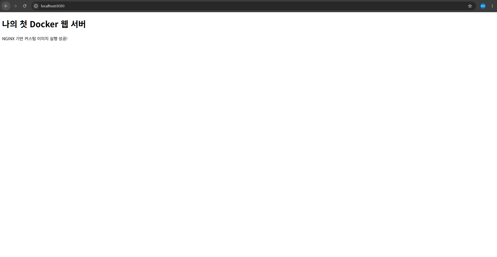
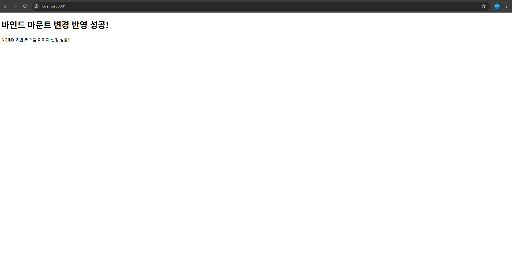
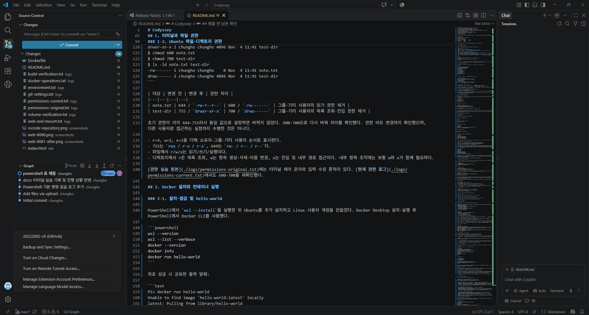
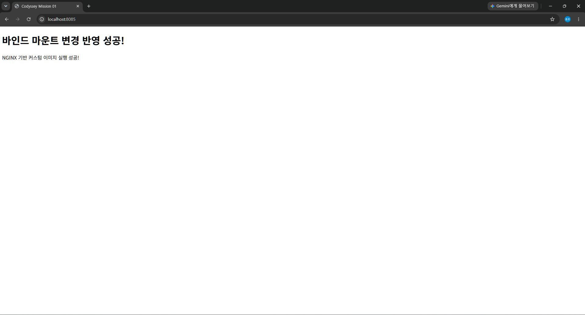

# Codyssey · 미션 01 개발 환경 구성

대전 코디세이 첫 번째 미션으로, 터미널·Docker·Git을 이용해 개발 워크스테이션을 구성했다. NGINX 웹 서버를 직접 컨테이너화하고 **접속, 파일 변경 반영, 데이터 유지, 협업 저장소 연결**을 실제 명령과 출력으로 검증했다.

## 평가자가 먼저 볼 내용

| 평가 항목 | 확인한 결과 | 바로 볼 증거 |
|---|---|---|
| 터미널 기본 조작 | 생성·복사·이동·삭제·경로 확인 | [터미널 로그](./terminal-log.txt) |
| 파일·디렉토리 권한 | 644→600, 755→700 변경 | [변경 전후 로그](./logs/permissions-original.txt) |
| Docker 설치·운영 | 데몬 연결, hello-world, 목록·로그·리소스 확인 | [환경](./logs/environment.txt) · [운영 로그](./logs/docker-operations.txt) |
| 컨테이너 접속·종료 | attach 분리 시 유지, Bash 종료 시 종료, exec 종료 시 유지 | [attach](./logs/attach-verification.txt) · [exec](./logs/exec-verification.txt) |
| 커스텀 이미지 | Dockerfile 작성·빌드·웹 실행 | [Dockerfile](./Dockerfile) · [빌드 로그](./logs/build-verification.txt) |
| 포트 매핑 | 8080·8081 접속 및 주소창 포함 캡처 | [응답 로그](./logs/web-and-mount.txt) |
| 포트 충돌 진단·해제 — 평가 #16 | 충돌 재현→PID·프로세스 확인→해제→재사용 | [전체 실행 로그](./logs/port-conflict.txt) |
| 바인드 마운트 | 같은 주소에서 파일 수정 전후 응답 변경 | [전후 비교](./logs/bind-before-after.txt) |
| 볼륨 영속성 | 컨테이너 삭제·재생성 후 같은 데이터 조회 | [연속 검증](./logs/volume-before-after.txt) |
| Git·GitHub·VSCode | 사용자 설정·원격 연결·로그인·푸시 | [설정](./logs/git-settings.txt) · [SSH 푸시](./logs/github-ssh-success.txt) |
| 트러블슈팅 | 문제·가설·확인·해결·재검증 정리 | 아래 8절 |
| 보너스 1~5 | Compose 단일·멀티·운영, 환경 변수, SSH | 아래 9절 |

기본 명령은 교육장에서, 나머지는 개인 노트북에서 실습했다. 본문은 최종 확인 결과를 중심으로 정리했다. 로그에는 당시 기록과 2026-11-04 후속 검증이 구분되어 있으며, 최초 기록을 후속 결과로 바꾸지 않았다. [상세 수행 기록](./docs/mission-details.md)

## 1. 실행 환경과 프로젝트 구성

| 항목 | 환경 |
|---|---|
| 교육장 기본 명령 | Windows PowerShell 5.1.26100.9711 / 2026-11-02 |
| 개인 노트북 | Windows 11 Pro, 빌드 26200 / 2026-11-04 |
| 쉘·터미널 | Windows PowerShell 5.1 및 Ubuntu Bash, VSCode에서 저장소 작업 |
| 후속 검증 쉘 | PowerShell 7.6.5 |
| Linux | WSL 3.0.3.0, WSL2 배포판 Ubuntu 26.04.1 LTS |
| Docker | Docker Desktop의 Linux 엔진, CLI·서버 29.9.2 |
| Git / VSCode | 2.51.2.windows.1 / 1.144.1 |

WSL 프로그램 버전과 배포판 실행 방식인 WSL2는 서로 다른 항목이다. WSL Ubuntu와 Docker 컨테이너의 Ubuntu도 별개다. [버전 확인 명령·출력](./logs/environment.txt)

```text
Dockerfile                    커스텀 웹 이미지 제작
site/index.html               직접 작성한 웹 페이지
docker-compose.single.yml     단일 서비스 설정
docker-compose.yml            web + checker 설정
docker-compose.env.yml        환경 변수 실습 설정
nginx/default.conf.template   NGINX 수신 포트 템플릿
logs/                         명령·출력 증거
screenshots/                  브라우저·VSCode 캡처
docs/                         재현 절차·상세 수행 기록
```

아래 명령은 별도 표시가 없으면 **Windows PowerShell**에서 실행한다. 기존 실습 명령을 다시 실행할 때 이름·포트가 겹칠 수 있으므로, 처음부터 따라 할 때는 [재현 절차](./docs/reproduce.md)를 사용한다.

## 2. 터미널과 파일 권한

### 2-1. 기본 조작과 경로

**목적:** CLI에서 파일·폴더를 관리하고 현재 위치를 기준으로 경로를 해석한다.

**수행:** 교육장 PowerShell에서 다음 명령을 사용했다.

| 작업 | 명령 |
|---|---|
| 위치·숨김 파일 포함 목록 | `pwd`, `ls -Force` |
| 절대·상대 경로 이동 | `cd C:\Users\User\Documents\codyssey-practice\practice2`, `cd .\practice2`, `cd ..` |
| 폴더·빈 파일 생성 | `mkdir practice2`, `ni .\practice2\note.txt` |
| 내용 기록·조회 | `echo "CLI practice" > .\practice2\note.txt`, `cat .\practice2\note.txt` |
| 복사 | `cp .\practice2\note.txt .\practice2\copy.txt` |
| 이름 변경·이동 | `mv .\practice2\copy.txt .\practice2\backup.txt`, `mv .\practice2\backup.txt .` |
| 삭제 | `rm .\practice2\note.txt`, `rm .\practice2`, `rm .\backup.txt` |

**결과:** 생성한 빈 파일의 크기는 0이었고, 복사·이동한 파일에서도 같은 내용을 읽었다. 삭제 후 목록에서 연습 파일·폴더가 사라졌다.

```text
PS> cat .\practice2\note.txt
CLI practice
PS> cat .\backup.txt
CLI practice
```

**해석:** 절대 경로는 전체 위치를 지정한다. 상대 경로 `.\practice2`는 현재 폴더 기준이며, `..`는 상위 폴더다. 따라서 상대 경로의 대상은 실행 위치에 따라 달라진다.

**증거:** [전체 기본 명령과 출력](./terminal-log.txt)

### 2-2. 파일·디렉토리 권한

**목적:** 권한 숫자와 r/w/x의 관계를 확인한다.

**수행:** `wsl -d Ubuntu`로 들어가 Ubuntu 홈의 `~/codyssey-practice/permissions`에서 파일·디렉토리를 만들었다. 아래는 **Ubuntu Bash** 명령이다.

```bash
touch note.txt
mkdir test-dir
chmod 644 note.txt
chmod 755 test-dir
ls -ld note.txt test-dir
chmod 600 note.txt
chmod 700 test-dir
ls -ld note.txt test-dir
```

**결과:**

| 대상 | 변경 전 | 변경 후 |
|---|---|---|
| note.txt | `644 / -rw-r--r--` | `600 / -rw-------` |
| test-dir | `755 / drwxr-xr-x` | `700 / drwx------` |

**해석:** r=4, w=2, x=1을 더해 소유자·그룹·기타 사용자 순서로 읽는다. 755는 `rwx/r-x/r-x`, 644는 `rw-/r--/r--`다. 이번 변경으로 그룹·기타 사용자의 권한을 제거했다. 다른 사용자로 접근하는 실험까지 수행한 것은 아니다.

파일의 r/w/x는 읽기/쓰기/실행이다. 디렉토리에서는 목록 조회/항목 생성·삭제·이름 변경/진입·경로 접근을 뜻하며, 내부 항목 조작에는 보통 w와 x가 함께 필요하다.

**증거:** [실습 당시 전후 로그](./logs/permissions-original.txt) · [현재 권한 재확인](./logs/permissions-current.txt)

## 3. Docker 설치·실행·운영

**목적:** CLI와 데몬의 연결을 확인하고 컨테이너 상태를 관리한다.

**수행:** WSL·Ubuntu와 Docker Desktop을 설치한 후 다음을 실행했다.

```powershell
wsl --version
wsl --list --verbose
docker --version
docker info
docker run hello-world
docker run -it --name ubuntu-practice ubuntu bash
```

Ubuntu 컨테이너 내부에서는 `pwd`, `ls -la`, `echo "Hello from Ubuntu container"`, `cat /etc/os-release`를 실행했다. 운영 상태는 다음 명령으로 확인했다.

```powershell
docker images
docker ps
docker ps -a
docker logs ubuntu-practice
docker stats --no-stream
docker stop ubuntu-practice
docker start ubuntu-practice
```

**결과:** Docker CLI·서버 버전은 29.9.2였고 hello-world가 아래 메시지를 출력했다. 이미지 다운로드는 로컬에 이미지가 없을 때 docker run 과정에서 자동 수행됐다.

```text
Hello from Docker!
This message shows that your installation appears to be working correctly.
```

**해석:** `--version`은 CLI 버전, `info`는 데몬 연결과 서버 정보를 확인한다. `ps`는 실행 중인 컨테이너, `ps -a`는 종료된 컨테이너까지 표시한다. hello-world는 출력 후 종료하므로 Exited (0)이 정상이다. logs는 표준 출력·오류, stats는 리소스 사용량이다.

**증거:** [설치·데몬 점검](./logs/environment.txt) · [이미지·컨테이너·로그·리소스 출력](./logs/docker-operations.txt)

### 3-1. attach와 exec의 종료 동작

**목적:** 연결 해제와 프로세스 종료를 구분한다.

**수행:** Bash가 주 프로세스인 컨테이너에 attach하고 Ctrl+P, Ctrl+Q로 분리한 뒤, 다시 연결해 exit했다. 별도로 sleep infinity 컨테이너에 exec로 Bash를 실행하고 종료했다.

**결과:**

| 조작 | 실제 확인 결과 |
|---|---|
| attach 후 연결만 분리 | `Up`, `Running=true` |
| 다시 attach한 Bash에서 exit | `Exited (0)`, `Running=false` |
| exec로 추가한 Bash만 종료 | 주 프로세스 sleep infinity 및 `Running=true` 유지 |

**해석:** attach는 기존 주 프로세스의 입출력에 연결하고 exec는 새 프로세스를 만든다. 컨테이너의 수명은 주 프로세스와 연결된다. 초기 실습의 종료 코드 137과 후속 검증의 정상 종료 0은 별도 기록으로 구분했다.

**증거:** [실제 대화형 attach 검증](./logs/attach-verification.txt) · [비대화형 exec 재검증](./logs/exec-verification.txt)

## 4. 커스텀 이미지와 웹 접속

**목적:** 기존 이미지를 바탕으로 직접 만든 웹 페이지를 실행한다.

**수행:** 웹 서버가 준비된 nginx:alpine을 선택하고 다음 Dockerfile을 작성했다.

```dockerfile
FROM nginx:alpine
LABEL org.opencontainers.image.title="codyssey-web"
COPY site/ /usr/share/nginx/html/
EXPOSE 80
```

LABEL은 프로젝트 정보를 추가하고 COPY는 기본 콘텐츠를 직접 만든 HTML로 교체한다. Dockerfile이 있는 폴더에서 빌드·실행했다.

```powershell
docker build -t codyssey-web:1.0 .
docker run -d --name codyssey-web-8080 -p 8080:80 codyssey-web:1.0
curl.exe http://localhost:8080
```

**결과:** 웹 서버 컨테이너가 실행되고 브라우저에 직접 작성한 페이지가 표시됐다.



**해석:** 이미지는 실행에 필요한 파일·설정을 담은 기반이고 컨테이너는 그 기반으로 실행하는 인스턴스다. `-p 8080:80`은 호스트 8080을 컨테이너 80에 연결한다. EXPOSE는 포트 정보이며 실제 호스트 연결은 -p로 설정한다.

현재 저장소의 HTML은 마운트 실습 후 수정한 버전이므로 새로 빌드하면 사진의 초기 제목과 다르다. 빌드 로그는 현재 소스를 별도 태그 readme-check로 재빌드한 결과다.

**증거:** [Dockerfile](./Dockerfile) · [웹 소스](./site/index.html) · [빌드 로그](./logs/build-verification.txt) · [HTTP 응답](./logs/web-and-mount.txt)

### 4-1. 포트 충돌 진단·해제 — 평가 #16

**목적:** 충돌 원인을 PID·프로세스·컨테이너로 좁히고 포트를 해제한다.

**수행:** 별도 컨테이너 두 개에 같은 127.0.0.1:18085를 지정해 충돌을 재현하고 다음 명령으로 조사했다.

```powershell
netstat -ano -p tcp | Select-String ":18085\s"
Get-NetTCPConnection -LocalPort 18085 -State Listen | Select-Object LocalAddress,LocalPort,State,OwningProcess
Get-NetTCPConnection -LocalPort 18085 -State Listen | Select-Object -ExpandProperty OwningProcess -Unique | ForEach-Object { Get-Process -Id $_ | Select-Object Id,ProcessName }
docker ps --filter publish=18085 --format "table {{.Names}}\t{{.Ports}}"
```

**결과:**

```text
충돌: Bind for 127.0.0.1:18085 failed: port is already allocated
조회: TCP 127.0.0.1:18085  0.0.0.0:0  LISTENING  26500
프로세스: 26500 com.docker.backend
컨테이너: codyssey-port-holder 127.0.0.1:18085->80/tcp
```

포트를 점유한 컨테이너를 중지한 뒤 재조회했다.

```text
PS> docker stop codyssey-port-holder
codyssey-port-holder
PS> netstat -ano -p tcp | Select-String ":18085\s"
(출력 없음)
```

실패한 컨테이너를 삭제하고 같은 포트 옵션으로 새로 생성한 뒤 curl로 HTML과 ExitCode=0을 확인했다.

**해석:** 호스트의 점유 PID는 Docker 포트 전달 프로세스였다. 엔진 전체를 종료하는 대신 해당 컨테이너만 중지해 포트를 해제했다. PID는 실행 시점마다 달라진다. 검증 후 임시 컨테이너만 정리했다.

**증거:** [충돌 재현·PID 확인·해제·재조회·동일 포트 재사용 전체 로그](./logs/port-conflict.txt)

## 5. 바인드 마운트와 볼륨

### 5-1. 바인드 마운트: 파일 변경 반영

**목적:** 호스트 파일 수정이 재빌드 없이 웹 응답에 반영되는지 확인한다.

**수행:** 최초 작업 폴더에서 site를 웹 경로에 읽기 전용으로 연결하고 HTML 제목을 수정했다.

```powershell
docker run -d --name codyssey-web-bind -p 8081:80 --mount "type=bind,source=$($PWD.Path)\site,target=/usr/share/nginx/html,readonly" codyssey-web:1.0
```

**결과:** 이미지 파일을 사용하는 8080은 원래 제목을 유지했고 마운트를 사용하는 8081은 수정된 제목을 표시했다.



같은 주소의 전후 비교는 별도 사본을 연결한 8084에서 재검증했다.

| 비교 시점 | localhost:8084 응답의 제목 |
|---|---|
| 호스트 파일 수정 전 | 바인드 마운트 변경 반영 성공! |
| 호스트 파일 수정 후 | 바인드 마운트 재검증 완료! |

**해석:** COPY는 빌드 시점의 파일을 담지만 바인드 마운트는 연결된 호스트 폴더를 사용한다. readonly는 컨테이너의 쓰기를 막으며 호스트 수정은 가능하다. 8080·8081 사진은 서로 다른 컨테이너의 비교이고, 동일 주소 전후 증거는 8084 로그다.

기존 8081은 `C:\Users\user\codyssey-web\site`를 연결한다. 제출 저장소의 site는 사본이므로 재현할 때는 저장소 경로로 새 마운트를 설정해야 한다.

**증거:** [설정·8080/8081 응답](./logs/web-and-mount.txt) · [동일 주소의 수정 명령·전후 응답](./logs/bind-before-after.txt)

### 5-2. 볼륨: 컨테이너 삭제 후 데이터 유지

**목적:** 데이터 수명을 컨테이너와 분리한다.

**수행:** 볼륨 생성→파일 저장→삭제 전 조회→컨테이너 삭제→새 컨테이너에 같은 볼륨 연결→재조회 순서로 검증했다.

```powershell
docker volume create codyssey-final-data
docker run -d --name codyssey-final-before --mount type=volume,source=codyssey-final-data,target=/data ubuntu sleep infinity
docker exec codyssey-final-before bash -c "echo 'Codyssey volume persistence test' > /data/hello.txt"
docker exec codyssey-final-before cat /data/hello.txt
docker rm -f codyssey-final-before
docker run -d --name codyssey-final-after --mount type=volume,source=codyssey-final-data,target=/data ubuntu sleep infinity
docker exec codyssey-final-after cat /data/hello.txt
```

**결과:** 삭제 전후 모두 `Codyssey volume persistence test`를 출력했다. 검증 후 이 임시 컨테이너와 볼륨만 삭제했다.

**해석:** 볼륨은 컨테이너의 쓰기 계층과 별개여서 컨테이너를 삭제해도 남는다. 바인드 마운트는 지정한 호스트 경로, 이름 있는 볼륨은 Docker가 관리하는 저장소를 연결한다.

**증거:** [삭제 전후 연속 로그](./logs/volume-before-after.txt) · [기존 codyssey-data의 추가 조회](./logs/volume-verification.txt)

## 6. Git·GitHub·VSCode

**목적:** 로컬 변경 이력을 관리하고 원격 저장소에서 결과물을 공유한다.

**수행:** 사용자 정보와 기본 브랜치를 설정하고 저장소를 복제해 VSCode에서 열었다. 아래 이메일은 공개 문서용 자리표시자다.

```powershell
git config --global user.name "20222002-ch"
git config --global user.email "<GitHub 등록 이메일>"
git config --global init.defaultBranch main
git config --list
git remote -v
git branch --show-current
code .
```

**결과:** 사용자 이름과 main 브랜치, 원격 연결을 확인했다. 계정 메뉴에 20222002-ch (GitHub)가 표시됐으며, 결과 파일을 커밋·푸시했다. 현재 origin은 SSH 주소다.



**해석:** Git은 로컬 버전 관리 도구이고 GitHub는 원격 저장소 공유·협업 서비스다. commit은 로컬 이력 저장, push는 원격 전송이다. 위 사진은 커밋 전 상태이며 최종 푸시 증거는 로그에서 확인한다.

**증거:** [초기 Git 설정·HTTPS 연결 로그](./logs/git-settings.txt) · [저장소 열기 화면](./screenshots/vscode-repository.png) · [SSH 푸시 성공](./logs/github-ssh-success.txt)

## 7. 처음부터 재현하기

Docker Desktop의 Linux 엔진이 실행된 Windows PowerShell을 기준으로 한다. Git·Docker가 설치되어 있고 사용할 호스트 포트가 비어 있어야 한다.

```powershell
git clone https://github.com/20222002-ch/Codyssey.git
cd Codyssey
docker info
docker build -t codyssey-repro:1.0 .
docker run -d --name codyssey-repro-web -p 8082:80 codyssey-repro:1.0
curl.exe http://localhost:8082
```

HTML이 나오면 웹 서버 재현에 성공한 것이다. [마운트·볼륨·attach 비교 및 정리까지의 전체 재현 절차](./docs/reproduce.md)를 이어서 실행할 수 있다. 이미 같은 컨테이너 이름·포트가 있으면 별도 이름·포트를 사용한다. 개인 PC 경로는 `$PWD.Path`로 대체한다.

## 8. 트러블슈팅

| 문제 | 원인 가설 | 확인 | 해결·대안 | 재확인·증거 |
|---|---|---|---|---|
| Docker API 연결 실패 | 엔진 미실행 또는 WSL 준비 미완료 | WSL 버전·배포판·Docker 상태 점검 | Ubuntu 초기 설정과 엔진 상태를 확인하고 재시도; 단일 원인은 확정하지 않음 | hello-world 성공 · [환경](./logs/environment.txt) |
| Ubuntu에서 wsl 명령 실패 | 설치 실패 또는 잘못된 셸 | Ubuntu Bash 프롬프트 확인 | exit로 PowerShell에 돌아가 실행 | WSL2 배포판 목록 확인 · [환경](./logs/environment.txt) |
| 컨테이너에서 docker 명령 실패 | 호스트와 컨테이너 혼동 | root@컨테이너ID 프롬프트·로그 확인 | 운영 명령을 호스트 PowerShell에서 실행 | ps·logs·stats 성공 · [운영](./logs/docker-operations.txt) |
| 호스트 포트 충돌 | 다른 컨테이너의 포트 점유 | netstat→PID→프로세스→컨테이너 조회 | 점유 컨테이너 중지 후 포트 재사용 | 같은 포트 HTTP 성공 · [충돌·해제](./logs/port-conflict.txt) |
| 환경 변수 실습 후 접속 실패 | 서버가 종료됐을 가능성 | 로그에서 down 실행, 서비스 없음 확인 | 같은 설정으로 up | HTTP 응답 성공 · [재실행](./logs/compose-environment-restart.txt) |
| SSH 공개키 인증 실패 | 키 미등록 또는 키 암호 미입력 | 등록 키 비교·서버 수락 여부 확인 | 올바른 공개키 등록 후 대화형 터미널에서 키 암호 입력 | SSH push 성공 · [실패](./logs/github-ssh.txt) / [성공](./logs/github-ssh-success.txt) |

입력 오류와 초기 실패를 포함한 상세 경위는 [상세 수행 기록](./docs/mission-details.md)에 보관했다.

## 9. 보너스 과제

### 9-1. Compose 단일 서비스

**목적·수행:** 실행 설정을 YAML로 공유하기 위해 [단일 서비스 파일](./docker-compose.single.yml)에 build와 포트 매핑을 작성했다.

```powershell
docker compose -p codyssey-single -f docker-compose.single.yml up -d --build
docker compose -p codyssey-single -f docker-compose.single.yml ps
curl.exe http://localhost:8085
docker compose -p codyssey-single -f docker-compose.single.yml down
```

**결과·해석:** 웹 페이지에 접속했다. 긴 docker run 옵션을 파일로 보관해 같은 조건으로 다시 실행할 수 있었다. 원래 실습은 기본 파일에서 진행했고 현재는 보관한 단일 파일로 재현한다. 멀티 서비스도 8085를 쓰므로 두 설정은 동시에 실행하지 않는다.

**증거:** [단일 서비스 로그](./logs/compose-single.txt)



### 9-2. 멀티 컨테이너·네트워크

**목적·수행:** [기본 Compose 파일](./docker-compose.yml)에 NGINX web과 Alpine checker를 정의하고 서비스 이름으로 통신했다.

```powershell
docker compose -p codyssey-bonus up -d --build
docker compose -p codyssey-bonus ps
docker compose -p codyssey-bonus exec checker wget -qO- http://web:80
```

**결과·해석:** 두 서비스가 Up이고 checker에서 HTML을 받았다. 같은 네트워크의 서비스 이름 web을 사용해 내부 포트 80으로 접근했다. checker 내부의 localhost는 web이 아닌 checker 자신이다.

**증거:** [멀티 서비스 상태·통신 로그](./logs/compose-multi.txt)

### 9-3. Compose 운영

**목적·수행:** 상태→요청→로그→종료→재실행 순서로 관리했다.

```powershell
docker compose -p codyssey-bonus ps
curl.exe http://localhost:8085
docker compose -p codyssey-bonus logs --tail 30 web
docker compose -p codyssey-bonus logs --tail 30 checker
docker compose -p codyssey-bonus down
docker compose -p codyssey-bonus ps -a
docker compose -p codyssey-bonus up -d
```

**결과·해석:** HTTP 200 요청을 확인했고, down 후 컨테이너가 제거됐다. 같은 설정으로 재실행한 뒤 통신도 성공했다. checker의 주 프로세스 sleep infinity는 출력하지 않으므로 로그가 비어 있어도 정상이다.

**증거:** [운영 전체 로그](./logs/compose-operations.txt)

### 9-4. 환경 변수로 NGINX 포트 변경

**목적·수행:** [Compose 환경 설정](./docker-compose.env.yml)에서 NGINX_PORT를 주입하고 [템플릿](./nginx/default.conf.template)의 listen에 반영했다.

```powershell
$env:NGINX_PORT = "8088"
docker compose -p codyssey-env -f docker-compose.env.yml up -d --build
docker compose -p codyssey-env -f docker-compose.env.yml exec web cat /etc/nginx/conf.d/default.conf
curl.exe http://localhost:8086
$env:NGINX_PORT = "9090"
docker compose -p codyssey-env -f docker-compose.env.yml up -d
docker compose -p codyssey-env -f docker-compose.env.yml exec web cat /etc/nginx/conf.d/default.conf
curl.exe http://localhost:8086
```

**결과:**

| 항목 | 변경 전 | 변경 후 |
|---|---|---|
| 실제 NGINX 설정 | listen 8088; | listen 9090; |
| 호스트 주소 | localhost:8086 | localhost:8086 |
| 응답 | HTML | HTML |

**해석:** HTML·Dockerfile을 수정하지 않고 실제 서버 수신 포트를 바꿨다. 호스트 포트는 8086으로 유지했다. 종료 시 같은 Compose 명령에 down을 사용하고 `Remove-Item Env:NGINX_PORT`로 셸 변수를 제거한다.

**증거:** [실제 포트 변경·응답](./logs/compose-environment.txt)

### 9-5. GitHub SSH

**목적·수행:** 별도 Ed25519 키의 공개키를 GitHub Authentication Key로 등록하고 저장소에 사용할 키·원격 주소를 설정했다. 다른 PC에서는 자신의 키 경로로 바꾼다.

```powershell
git config --local core.sshCommand "ssh -i C:/Users/user/.ssh/id_ed25519_codyssey -o IdentitiesOnly=yes"
git remote set-url origin git@github.com:20222002-ch/Codyssey.git
git remote -v
git push origin main
```

**결과:** 키 암호 입력 후 보너스 결과물 f7c5625를 SSH로 전송했다.

```text
To github.com:20222002-ch/Codyssey.git
   d091ff1..f7c5625  main -> main
```

**해석:** 공개키는 서버에 등록하고 개인키는 PC에 보관한다. 키 암호는 GitHub 비밀번호와 별개다. 암호 입력이 불가능한 자동 실행의 BatchMode 실패와 사용자 터미널의 SSH 푸시 성공을 구분했다.

**증거:** [등록·키 수락 확인](./logs/ssh-registration-check.txt) · [SSH 푸시 성공 원본](./logs/github-ssh-success.txt)

## 10. 제출 체크리스트

- [x] 프로젝트 개요·실행 환경·재현 절차
- [x] 터미널 명령·권한 변경 전후
- [x] Docker 점검·운영·Ubuntu·attach/exec 비교
- [x] Dockerfile·웹 소스·빌드·포트 접속 캡처
- [x] 평가 #16 포트 점유 프로세스 확인·해제 로그
- [x] 바인드 마운트 변경 전후·볼륨 영속성
- [x] Git 설정·VSCode 로그인·GitHub 반영
- [x] 트러블슈팅 2건 이상
- [x] 보너스 1~5의 설정·실행 증거
- [x] 로그·캡처에 비밀번호·토큰·개인키가 없는지 점검

전체 명령 출력은 연결된 로그에서 확인할 수 있다. 교육장·권한 실습 원본에는 터미널 제어 문자가 남아 있으며, 보너스 로그는 NUL과 줄 끝 공백만 제거했다. 공개 문서의 이메일·인증 설정은 마스킹했다.
